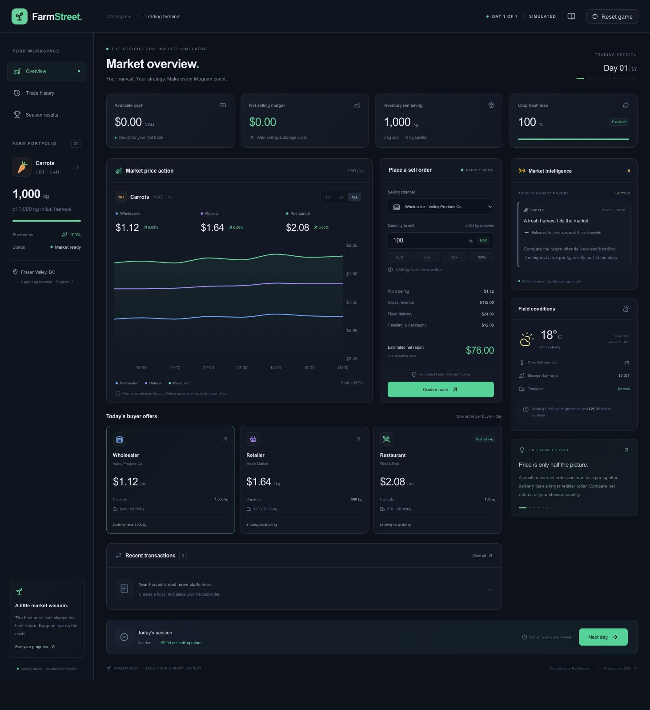

# FarmStreet 🌱

A complete, browser-local agricultural market simulator. Take a fictional 1,000 kg carrot harvest through seven Canadian market sessions: compare buyers, sell or hold inventory, absorb storage and spoilage costs, and review your strategy against an immediate-sale baseline.

All prices, buyers, news, weather, and market conditions are **simulated**. No accounts, API keys, real trades, payments, or backend are involved.

## Launch

Use Node.js 22 LTS or later and npm.

```bash
npm install
npm run dev
```

Open [http://localhost:3000](http://localhost:3000). The game starts with a complete scenario. Progress automatically saves in this browser’s localStorage. Reset Game clears the current season and starts fresh.

```bash
npm test               # 46 unit and state tests
npm run test:watch     # watch tests during development
npm run typecheck     # TypeScript checks
npm run lint          # Next.js, accessibility, and React lint rules
npm run format:check  # verify source formatting
npm run format        # format source files
npm run build         # optimized production build
npm start             # serve the production build
```

## How to play

A spotlight tour opens automatically every time you launch or reload the game, including when you resume a saved season. It highlights actual dashboard controls, scrolls them into view, and visits the real Trade History and Results pages. Use **Next** and **Back**, jump between steps, or press the always-visible **Skip tutorial** button at the top-right (Escape also skips). Skipping or finishing returns you to the game without changing your harvest or trades. The header’s book button reopens the tour from the beginning. See the [written tutorial](docs/tutorial/README.md) for a reference outside the game.

1. Compare today’s wholesale, retail, and restaurant offers. Each has its own capacity, delivery fee, and per-kg handling/packaging cost.
2. Select a buyer, enter kilograms (up to two decimal places), and review the full cost breakdown. Percent buttons use the smaller of remaining inventory and that buyer’s capacity.
3. Confirm the sale. Inventory and cash update immediately. Each buyer accepts **one order per day**, even if you do not use all its capacity.
4. Choose **Next day**, review the holding costs, and advance. Storage is charged on remaining inventory **before** spoilage is removed. The current day’s displayed holding rates govern that overnight period.
5. Trade on Day 7, then choose **End season** to see your results. Advancing from Day 6 does not end the game. There is no extra storage charge after the final session.

Today’s buyer cards highlight the highest net return **per kg at each buyer’s maximum feasible quantity**. This is a comparison, not a guaranteed optimal strategy. Intraday chart traces are illustrative observations for days already revealed; actual orders execute at the daily buyer quote. Chart range and channel toggles work without exposing future sessions.

## Accounting and simulation rules

- **Gross revenue** = quantity × buyer price.
- **Selling costs** = fixed delivery fee + quantity × per-kg handling/packaging cost.
- **Net selling return per order** = gross revenue − selling costs.
- **Net selling margin / cash** = cumulative gross revenue − selling costs − storage costs.
- Currency and kilograms round to two decimal places. Variable fees and gross revenue round independently, then net return is calculated from those rounded amounts.
- A low-volume order can lose money because of its delivery fee. The preview warns you, but valid loss-making orders are allowed.
- Starting cash is $0. Storage and loss-making orders can produce a negative cash balance; this simulator does not impose a financing constraint.
- Freshness is a quality indicator. Spoilage directly reduces saleable inventory; freshness does not apply a second price discount.
- Remaining inventory after the final session has **zero salvage value**. Results list spoiled and unsold quantities separately and in total.
- Production costs are excluded. **Net selling margin is not full farm profit.**
- Baseline: sell all 1,000 kg to the Day 1 wholesaler at $1.12/kg, less $24 delivery and $0.12/kg handling = **$976**. Its 1,000 kg capacity makes this baseline feasible.

The scenario includes a restaurant demand surge, bumper harvest, highway closure, grocery promotion, extreme heat, and supply shortage. Daily prices, capacities, and expenses **already include** their event effects, so the engine never applies a modifier twice. No future events or prices appear in the UI. The scenario is deterministic and inspectable in the source; it is not a secrecy or anti-cheating system.

## Architecture

```text
app/                  Next.js App Router entry points, metadata, global theme
components/
  layout/             Dashboard shell, header, sidebar, session controls
  farm/               Inventory and cash metrics
  market/             Recharts history, channel quotes, buyer comparison
  trading/            Sell form, cost preview, transaction table
  events/             News, conditions, educational insights
  results/            Season results, baseline comparison, takeaways
  ui/                 Local shadcn/ui Button and Radix Dialog components
  tutorial/           Automatic spotlight tour, page targets, positioning, styles
engine/
  game.ts             Pure initialization and daily transitions
  trading.ts          Validation, cost preview, immutable order execution
  inventory.ts        Overnight storage, spoilage, freshness
  market.ts           Buyer lookup, capacity, price movements
  scoring.ts          Final accounting, baseline, contextual takeaways
  saves.ts            Validate and replay saved orders to restore state
data/
  scenarios.ts        Immutable fictional seven-day scenario and crop model
  market-provider.ts  MarketDataProvider contract
  simulated-provider.ts  Read-only current-day and revealed-history access
store/gameStore.ts    Zustand actions and localStorage persist middleware
types/game.ts         Shared TypeScript models
tests/                Trading, game-loop, accounting, persistence/reset tests
```

React components render and collect input. They invoke Zustand actions rather than mutate state. Actions call pure TypeScript engine functions; the provider supplies read-only daily market data. Only mutable game data persists. Hydration waits until the client loads, avoiding server/client mismatches. Save recovery replays validated transactions and daily transitions rather than trusting cached balances. Incompatible or invalid saves return to a fresh season.

`MarketDataProvider` is the replacement point for a future real-data adapter. A future `RealMarketProvider` can supply the same crop/day/history models; network fetching and data normalization should happen at that boundary. There is no live integration in this MVP.

## Verification

46 Vitest tests cover eligible and rejected sales, exact expenses, fractional kilograms, immutable state, different buyers, one order per buyer/day, stale quotes, negative-return orders, holding costs, event rates, daily availability, trading on Day 7, finishing the game, no phantom final overnight charge, harvest conservation, cash reconciliation, final scoring, revealed-only history, replayed saves, corrupt saves, actual Zustand reset persistence, and responsive spotlight-tour positioning, and isolated development/production output folders.

Manual production-browser verification covered desktop and mobile layouts, maximum-capacity sales, same-day sales to different buyers, save/reload, advancing through every market event, trading on Day 7, final results, and Play Again. A complete run (160 kg to the Day 1 restaurant, then 220 kg to the Day 7 restaurant and the remaining 453.86 kg to wholesale) produced **$1,131.17** after selling and storage expenses, **$155.17 above baseline**. The production route returned HTTP 200 with no browser console errors or warnings.



## Development and production build folders

Development uses `.next-dev/`; `npm run build` and `npm start` use `.next/`. These are separate sibling folders so running a production build while the dev server is open cannot overwrite its JavaScript chunks. The setting lives in `next.config.mjs`. Both folders are generated and ignored by Git, ESLint, and Prettier.

If an older running server shows `a[d] is not a function`, missing-chunk errors, or a loading screen after a build, stop it with Ctrl+C, run `npm run dev` again, then reload the browser. The updated configuration prevents this shared-cache collision. Your game save lives in browser localStorage and is unaffected by rebuilding or restarting the server.

## Deploy to Vercel

1. Push this repository to GitHub.
2. Import it in Vercel and select the **Next.js** preset.
3. Use `npm run build` as the build command and the default output settings. Select Node.js 22.x or a later supported version.
4. Deploy. No environment variables or API credentials are required.

You can also run `npx vercel` from the repository if you already have a Vercel account. Deployment is not performed by this project setup.

## MVP scope

One crop, one deterministic seven-day scenario, three fictional buyer channels, and browser-local saves. Each order settles immediately; there are no in-transit shipments, financing costs, full production budgets, or inventory purchases. Refreshing preserves progress within the same browser and origin; saves do not sync between devices. If localStorage is blocked, the game remains playable in memory and displays a warning.

Built with Next.js App Router, React, TypeScript, Tailwind CSS v4, shadcn/ui patterns with Radix primitives, Recharts, Zustand persist, Lucide, and Vitest. The lockfile records the installed dependency versions.
