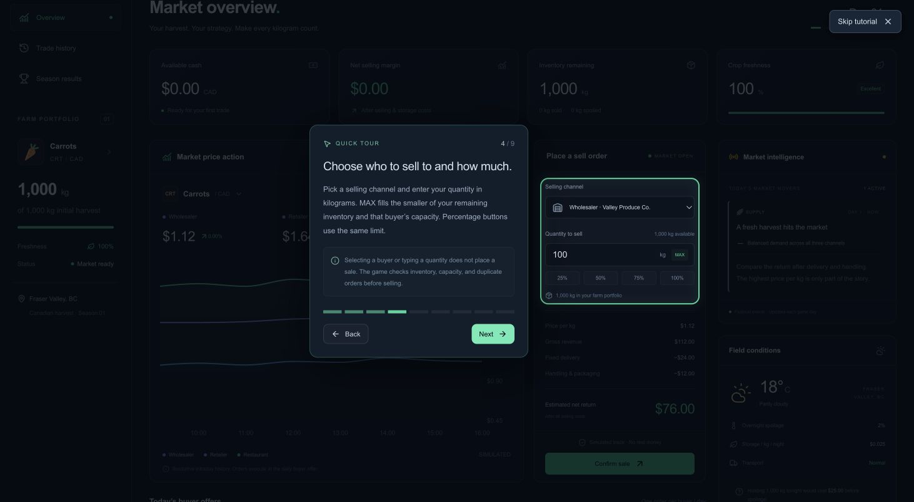

# FarmSmart player guide

The in-game **quick tour** opens every time you launch or reload FarmSmart. It highlights real controls on the dashboard and opens the actual Trade History and Results pages to show you where things are. The rest of the screen dims while a green outline marks the current area.

Use **Next** and **Back**, or click the progress bars to jump between the nine steps. **Skip tutorial** stays visible at the top-right on every step. Escape also closes the tour. Skipping or finishing returns you to the market (or your final results if the season has ended), preserving your saved progress. The book button in the header replays the tour from the beginning.

The tour is a walkthrough: it does not place trades or advance days. Finish or skip it to use the highlighted controls.

## 1. Understand your harvest

You start a new season with 1,000 kg of carrots, 100% freshness, and $0 CAD. You have seven simulated days to sell the harvest. Your goal is to maximize your **net selling margin** after selling and storage expenses. Production costs are excluded, so this is not full farm profit.

The top cards show your cash, selling margin, inventory, and freshness. The portfolio sidebar tracks your remaining harvest. On a small screen, the navigation collapses to icons.

## 2. Compare the market

Reveal one of the three **Daily scenario** cards above the chart before trading or advancing. The selected card changes buyer prices for this day and may close a buyer. The other cards stay hidden; tomorrow brings a new draw. Your draw and choice survive reloading.

Read **Today’s buyer offers**:

- **Wholesaler:** lower price, larger purchasing capacity, and lower per-kg handling costs.
- **Retailer:** a middle ground on price and capacity, with packaging and delivery expenses.
- **Restaurant:** a higher quoted price, smaller capacity, and higher per-kg handling costs.

**Market intelligence** explains current news. **Field conditions** shows transport and overnight risks. Events can change prices, capacities, or expenses. Future sessions stay hidden until you advance.

Use **1D**, **3D**, or **ALL** to change the chart range. Click channel names under the chart to hide or show a line. Chart ticks illustrate historical movement; sales execute at the daily buyer offer.

## 3. Check what you keep

Open **Show Price Breakdown** above the buyer cards to see the market base, crop freshness, demand, channel and daily scenario multipliers, and resulting price per kg for every buyer. The highest quoted price is highlighted, but delivery and handling can still change the best net return. The panel also shows the other four simulated crop markets.

The tour points out the real order inputs and cost breakdown. After closing the tour, select a buyer and adjust your quantity to see the estimated return. Nothing is sold until you choose **Confirm sale**.

For example, at a $1.12/kg wholesale quote, selling 100 kg gives (your actual quote depends on demand and the selected scenario):

| Item               | Calculation                 |     Amount |
| ------------------ | --------------------------- | ---------: |
| Gross revenue      | 100 kg × $1.12              |    $112.00 |
| Delivery           | Fixed fee                   |    −$24.00 |
| Handling           | 100 kg × $0.12              |    −$12.00 |
| Net selling return | Revenue minus selling costs | **$76.00** |

Fixed delivery fees matter, especially on small orders. A valid order can lose money; the game warns you when costs exceed revenue.

## 4. Place a sale

1. Find **Place a sell order** on the overview dashboard.
2. Click a buyer card or choose a **Selling channel**.
3. Enter the **Quantity to sell**. Use **MAX** to fill the smaller of your inventory and buyer capacity. Percentage buttons use that same maximum.
4. Review the gross revenue, delivery, handling, and estimated net return.
5. Press **Confirm sale**. Inventory decreases and cash updates immediately.

Each buyer accepts **one order per day**, even if the first order uses less than their full capacity. You can sell to multiple different buyers on the same day. Invalid quantities, overselling, and duplicate orders are blocked.

Open **Trade history** in the sidebar to review all your executed orders and completed daily recaps.

## 5. Decide whether to hold

Press **Next Market Day** when you are done with the current session. Review the confirmation before advancing. You can choose **Keep trading** to return to today’s market.

For example, holding 400 kg after Day 1 costs $10 in storage. At 2% spoilage, 8 kg spoils, leaving 392 kg available the next day. Freshness falls from 100% to 93%.

Storage is charged before spoiled stock is removed. Freshness also changes each buyer’s price: restaurants penalize older crops more strongly than wholesalers. The pricing system uses the same freshness percentage shown in your portfolio. Holding rates can change with conditions. Cash can go below $0 if expenses exceed sales.

After you advance, read the previous day’s recap, then compare the new offers and news.

## 6. Finish the season

You can still trade on **Day 7**. When you have made your final sales, choose **End season**, then **See my results**. There is no extra overnight storage or spoilage after the last session.

Results show your revenue, selling expenses, storage costs, net selling margin, sold inventory, spoiled stock, and unsold stock. Unsold carrots have $0 salvage value.

Your strategy is compared with selling all 1,000 kg to the Day 1 wholesaler under the same opening conditions. At medium demand, its $1.12/kg offer minus $24 delivery and $120 handling produces **$976**. High or low opening demand changes this baseline for a new dynamic season. The benchmark excludes the random scenario card, including wholesale shutdowns. Existing migrated trades retain their original baseline. Read the three takeaways for feedback on your decisions.

**Play again** starts a new season. **Reset game** in the header also starts over after confirmation. Otherwise, progress saves automatically in the same browser.

## Where the tutorial lives

- `components/tutorial/Tutorial.tsx`: spotlight mask, anchored explanation, scrolling, page navigation, and skip action.
- `components/tutorial/steps.ts`: nine steps, their page destinations, target names, and explanations.
- `components/tutorial/positioning.ts`: pure functions that keep highlights and explanations within the viewport.
- `components/tutorial/tutorial.css`: spotlight and responsive explanation card styles.
- `components/layout/GameDashboard.tsx`: opens the tour after save hydration and returns to the game when skipped or finished.

Components expose stable `data-tour` markers so the tour follows the actual interface. The tour changes the displayed page, but never invokes trading, day-advance, or reset actions. Visibility is intentionally kept in memory, so it appears again at the next launch or reload. On small screens, explanations dock near the bottom and the page scrolls to keep the highlighted area above them.
